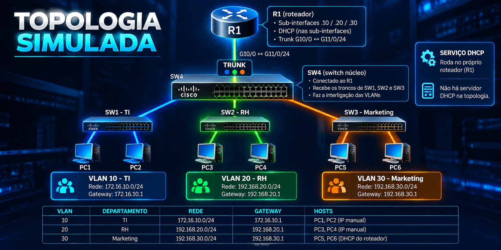

<p align="center">
  
</p>

Laboratório virtual interativo em **um único arquivo `index.html`** (HTML + CSS +
JavaScript puro, sem framework e sem build) para executar o desafio de redes:
segmentar uma empresa em **03 departamentos** (TI, RH e Marketing) com VLANs,
DHCP e Inter-VLAN Routing.

Tudo o que o arquivo precisa está embutido nele, inclusive o logo. Os únicos
ícones (Font Awesome) vêm de CDN, então **sem internet o laboratório continua
funcionando**, apenas os ícones não aparecem.

## Como usar

**Aluno**

1. Abra o **`index.html`** no navegador (Chrome, Edge ou Firefox), seja no
   computador ou direto no link **<https://desafiovlan.projetosdisruptivos.com.br>**.
   Não precisa instalar nada nem subir servidor.
2. Na primeira visita aparece a **Aula**: leia antes de começar, ela explica
   os conceitos do zero. Depois é só clicar em *Começar o laboratório*.
3. Digite seu nome no canto superior direito (aparece no certificado final).
4. Siga a **Trilha de aprendizagem** (ver abaixo): ela organiza o laboratório em
   4 etapas, com objetivo, tarefas e uma checagem de comprehendão por etapa.
4. Configure **do zero**: o laboratório abre sem nenhuma VLAN, sem portas
   configuradas, sem sub-interfaces e sem endereços de host. Use o console dos
   equipamentos e a tabela de endereçamento; o botão **Pedir dica** de cada
   tarefa ajuda quando precisar. O progresso é salvo automaticamente no
   navegador (`localStorage`) • pode fechar e continuar depois.
5. Ao terminar as 12 tarefas, siga o roteiro de
   [Depois de concluir as 12 tarefas](#depois-de-concluir-as-12-tarefas).

**Professor**

1. Abra o mesmo `index.html` e use o botão **Validar .cfg** para importar a
   entrega do aluno e gerar a ata de validação
   (veja [Validação do professor](#validação-do-professor-importar-cfg)).
2. O gabarito completo está no botão **Gabarito**, no cabeçalho da lista de
   tarefas, protegido por senha.


<p align="center">
  
</p>

<p align="center">
  <strong>Laboratório prático de VLANs, Inter-VLAN Routing e DHCP</strong><br>
  Segmentação de rede para os departamentos de TI, RH e Marketing.
</p>


| VLAN | Departamento | Rede | Gateway | Hosts |
|:---:|:---|:---|:---|:---|
| 10 | TI | `172.16.10.0/24` | `172.16.10.1` | PC1 e PC2 (IP manual) |
| 20 | RH | `192.168.20.0/24` | `192.168.20.1` | PC3 e PC4 (IP manual) |
| 30 | Marketing | `192.168.30.0/24` | `192.168.30.1` | PC5 e PC6 (DHCP do roteador) |

### Portas e conexões

| Equipamento | Porta | Conexão |
|:---|:---|:---|
| SW1 | `Gi1/0/1`, `Gi1/0/2` | PC1 e PC2 (access VLAN 10) |
| SW2 | `Gi1/0/3`, `Gi1/0/4` | PC3 e PC4 (access VLAN 20) |
| SW3 | `Gi1/0/5`, `Gi1/0/6` | PC5 e PC6 (access VLAN 30) |
| SW1, SW2 e SW3 | `Gi1/0/24` | Trunks para o SW4 |
| SW4 | `Gi1/0/1`, `Gi1/0/2`, `Gi1/0/3` | Trunks para SW1, SW2 e SW3 |
| SW4 | `Gi1/0/24` | Trunk para a interface `Gi0/0` do R1 |
| R1 | `Gi0/0.10`, `Gi0/0.20`, `Gi0/0.30` | Gateways das VLANs 10, 20 e 30 |

### Características da topologia

- **R1:** realiza o roteamento entre VLANs por subinterfaces 802.1Q e fornece DHCP para a VLAN 30.
- **SW4:** switch núcleo conectado ao roteador e aos três switches de acesso.
- **SW1, SW2 e SW3:** switches de acesso dos departamentos de TI, RH e Marketing.
- **DHCP:** executado no próprio roteador; não há servidor DHCP separado na topologia.
- **Inter-VLAN Routing:** permite a comunicação entre as redes por meio do R1.

## Tarefas (validação automática)

| # | Tarefa | O que o simulador verifica |
|:---:|:---|:---|
| 1 | VLAN 10 • TI | VLAN criada e nomeada no SW1 + portas Gi1/0/1 e Gi1/0/2 em access |
| 2 | VLAN 20 • RH | VLAN criada e nomeada no SW2 + portas Gi1/0/3 e Gi1/0/4 em access |
| 3 | VLAN 30 • Marketing | VLAN criada e nomeada no SW3 + portas Gi1/0/5 e Gi1/0/6 em access |
| 4 | Enlaces entre switches | 3 troncos até o SW4 ativos com as VLANs 10, 20 e 30 |
| 5 | Interfaces virtuais do roteador | `encapsulation dot1Q`, `ip address` e `no shutdown` das sub-interfaces |
| 6 | Inter-VLAN Routing | pings reais entre as três VLANs roteados pelo R1 |
| 7 | DHCP no roteador (só VLAN 30) | pool válido (192.168.30.0/24 + default-router 192.168.30.1) |
| 8 | IP automático em Marketing | PC5 e PC6 com lease contendo IP, máscara e gateway |
| 9 | IP manual em TI e RH | PC1•PC4 com endereço da sub-rede e gateway corretos |
| 10 | Ping dos gateways | os 6 hosts respondem ao gateway da sua VLAN |
| 11 | Comunicação inter-VLAN | testes cruzados Marketing↔TI↔RH |
| 12 | Validação completa | tarefas 1•11 concluídas + leases ativos |

Cada tarefa mostra o motivo da pendência (ex.: *"a sub-interface Gi0/0.30 está em
shutdown • aplique `no shutdown`"*), e a nota final vai de 0 a 100.

## Trilha de aprendizagem

O laboratório não é só um desafio de configuração. Ele é dividido em **quatro
etapas**, cada uma com objetivo próprio, tarefas que validam o que foi feito e
uma checagem de compreensão.

| Etapa | Tema | Tarefas |
|:---:|:---|:---|
| 1 | Fundamentos de segmentação | 1 a 4 |
| 2 | Roteamento entre VLANs | 5, 6 e 9 |
| 3 | Serviço DHCP | 7 e 8 |
| 4 | Validação e entrega | 10, 11 e 12 |

### Checagem de compreensão

Cada etapa tem **três perguntas** que não contam nota. A ideia é different
configurar de entender: se você errar, a resposta mostra a explicação do
conceito e um atalho para a seção da Aula que trata do assunto.

### Competências

O painel mostra **o que você domina**, independentemente da nota final, em oito
competências: criar VLANs, configurar access, montar troncos, criar
sub-interfaces, provar o Inter-VLAN Routing, endereçar hosts, entregar por DHCP
e validar.

### Modo prática

O botão **Modo prática** desliga a contagem da nota e libera o gabarito. As
tarefas continuam sendo validadas, então o aluno pode errar à vontade e
experimentar sem medo antes da avaliação.

### Meus erros

O laboratório classifica os erros que mais se repetem e mostra em **Meus
erros**, com a explicação de cada um. Errar a mesma coisa quatro vezes deixa de
ser sorte e vira um ponto de estudo com nome, com a dica do porquê.

Os erros mais comuns registrados são: esquecer o `no shutdown`, faltar
`encapsulation dot1Q`, faltar `ip address` do gateway, trunk sem as VLANs
liberadas, VLAN inexistente e pool DHCP não criado.

## Dicas progressivas

O laboratório **começa totalmente vazio**: nenhuma VLAN, nenhuma porta
configurada, nenhuma sub-interface e nenhum endereço de host. Nada é
pré-configurado • o aluno configure do zero.

Cada tarefa tem um botão **Pedir dica** com três níveis, revelados um a um:

1. a ideia (o que fazer e por quê);
2. os comandos-chave;
3. a sequência completa de comandos, se ainda precisar.

## Recursos

- **Console Cisco IOS simulado** por equipamento, com modos `user`, `priv`,
  `config`, `config-vlan`, `config-if` e `config-dhcp-pool`.
- Comandos `show vlan brief`, `show ip interface brief`, `show ip dhcp pool`,
  `show ip dhcp binding`, `show interfaces trunk`, `show interfaces status`,
  `show running-config`, `show startup-config`, `show ip route`, `ping`,
  `no ip dhcp pool`, `write memory`, `write erase`, `reload`, `default interface`,
  `copy running-config startup-config` e `ajuda`.
- **Autocomplete** com `Tab`, **linha de exemplos** ao digitar, ajuda contextual
  com `?`, `clear` e `cls`.
- Erros reais do IOS, por exemplo
  `% Access VLAN 10 does not exist on this switch.` ao associar uma porta access
  a uma VLAN inexistente.
- **Ping simulado** com animação do pacote pelo caminho real
  (host → switch → trunk → roteador → sub-interface → destino) e motivo da falha
  quando o enlace não está pronto.
- **DHCP (DORA)** animado no roteador, com escopo configurável pelo aluno
  (padrão `192.168.30.100•150`) e `ip dhcp excluded-address`.
- Todos os 8 cartões são **colapsáveis** e o estado do painel fica salvo.
- **Aula** em 9 seções, que abre sozinha na primeira visita: o problema do
  mundo real, o que é VLAN, access x trunk, por que o switch não roteia entre
  VLANs, DHCP e DORA, as vantagens do cenário, o mapa de ataque em 7 passos, o
  glossário e como mexer no laboratório. Dá para reabrir pelo botão **Aula**.
- **Trilha de aprendizagem** com 4 etapas, checagem de compreensão, painel de
  competências, modo prática e registro de erros recorrentes (ver abaixo).
- **Gabarito completo** protegido por senha (`#SFCYBER50`), com botão de
  mostrar/ocultar, copiar, imprimir e travar. O botão fica no cabeçalho da lista
  de tarefas, com um cadeado na barra de tarefas.
- **Tooltip** ao passar o mouse sobre roteador, switches e hosts mostra a
  configuração atual de cada equipamento.
- **Exportação `.cfg`** com o `running-config` dos 5 equipamentos, o
  endereçamento dos hosts e o checklist das tarefas.
- **Validação do `.cfg` pelo professor** (ver abaixo).
- Modais de **revisão teórica**, **referência de comandos** e **certificado**.

## Depois de concluir as 12 tarefas

1. **Salve a configuração** nos 5 equipamentos:
   `enable` • `copy running-config startup-config`. Sem isso um reinício da
   página descarta o trabalho.
2. **Rode os comandos de verificação**, cada um no equipamento certo:

   | Console | Comandos |
   | --- | --- |
   | SW1, SW2 e SW3 | `show vlan brief` • `show interfaces trunk` |
   | SW4 | `show interfaces trunk` (não tem VLAN, é o núcleo) |
   | R1 | `show ip interface brief` • `show ip dhcp pool` • `show ip dhcp binding` |

3. **Exporte o arquivo** pelo botão **Exportar .cfg**. Ele reúne o
   `running-config` de todos os equipamentos, o endereçamento dos hosts e o
   checklist das tarefas.
4. **Guarde o certificado** (Ctrl+P ou pelo menu do navegador) como comprovante
   e envie o `.cfg` na plataforma do curso.
5. Use **Revisão** e **Comandos** para revisar o conteúdo, ou **Reiniciar** para
   refazer o laboratório do zero.

## Validação do professor (importar `.cfg`)

O botão **Validar .cfg** serve para o professor conferir a entrega do aluno sem
instalar nada:

1. Abra o mesmo `index.html` e clique em **Validar .cfg**.
2. Selecione o arquivo `.cfg` exportado pelo aluno (ou cole o conteúdo na caixa
   de texto).
3. O programa **reconstrói a configuração do zero** e roda as 12 tarefas de novo,
   sem confiar no que está escrito no checklist do arquivo.
4. O relatório mostra nome do aluno, nota, decisão final
   (**Aprovado (12/12)**, **Parcial** ou **Não concluído**), quantos
   equipamentos e hosts vieram no arquivo e a lista de tarefas com o motivo da
   falha de cada uma.
5. Botão **Fechar e inspecionar a topologia** abre o laboratório já carregado com
   a configuração do aluno, para conferir portas e consoles. **Imprimir relatório**
   gera a ata de entrega.

Observações:

- O arquivo é texto comum e pode ser aberto no Bloco de Notas. Quem não exportou
  pelo laboratório é reconhecido como arquivo inválido.
- O escopo DHCP, os endereços dos hosts e as portas são lidos do arquivo, então
  qualquer endereçamento válido é aceito (o validador não fixa IPs do gabarito).
- As tarefas marcadas como feitas no arquivo são ignoradas na hora de
  validar: o que vale é a configuração importada.
- Cuidado ao lecionar: a senha do gabarito é do lado do navegador e não é
  segurança. Serve para o aluno não abrir antes da hora.

## Solução de referência

As dicas de nível 3 de cada tarefa trazem a sequência completa. Resumo:

```
! SW1
vlan 10 | name TI
interface gi1/0/1 e gi1/0/2 | switchport mode access | switchport access vlan 10
interface gi1/0/24 | switchport mode trunk | switchport trunk allowed vlan 10,20,30

! SW2  → vlan 20 | name RH ; gi1/0/3 e gi1/0/4 em access VLAN 20 ; gi1/0/24 trunk
! SW3  → vlan 30 | name Marketing ; gi1/0/5 e gi1/0/6 em access VLAN 30 ; gi1/0/24 trunk

! SW4 (núcleo)
interface gi1/0/1, gi1/0/2, gi1/0/3 | switchport mode trunk | allowed vlan 10,20,30
interface gi1/0/24 | switchport mode trunk | switchport trunk allowed vlan 10,20,30

! R1
interface gi0/0 | no shutdown
interface gi0/0.10 | encapsulation dot1Q 10 | ip address 172.16.10.1 255.255.255.0 | no shutdown
interface gi0/0.20 | encapsulation dot1Q 20 | ip address 192.168.20.1 255.255.255.0 | no shutdown
interface gi0/0.30 | encapsulation dot1Q 30 | ip address 192.168.30.1 255.255.255.0 | no shutdown
ip dhcp excluded-address 192.168.30.2 192.168.30.99
ip dhcp pool Marketing
 network 192.168.30.0 255.255.255.0
 default-router 192.168.30.1
 dns-server 8.8.8.8
```

## Arquivos

| Arquivo | Conteúdo |
|:---|:---|
| `index.html` | laboratório completo: estrutura, estilos, lógica, trilha de aprendizagem, simulação de rede, logo e favicon embutidos |
| `README.md` | esta documentação |
| `images/` | imagens ilustrativas usadas no cabeçalho deste README |
| `CNAME` | domínio customizado do GitHub Pages (`desafiovlan.projetosdisruptivos.com.br`) |

O laboratório em si é um único `index.html` e não depende de nenhum outro
arquivo, pasta, imagem ou biblioteca: funciona sozinho em qualquer computador,
inclusive offline. O `CNAME` só é usado pelo GitHub Pages para publicar no
domínio da escola.

## Publicação no GitHub Pages

O laboratório está publicado em:

**<https://desafiovlan.projetosdisruptivos.com.br>**

### Publicar pela primeira vez

São dois passos, um no GitHub e outro no provedor do domínio.

**1. Ativar o GitHub Pages (no GitHub)**

1. Abra **Settings** do repositório.
2. Vá em **Pages**, na barra lateral esquerda.
3. Em **Build and deployment**, a origem (**Source**) deve estar como
   **Deploy from a branch**.
4. Escolha a branch **main** e a pasta **/ (root)**.
5. Clique em **Save**. O GitHub publica em 1 a 2 minutos e mostra o endereço
   temporário `sandronsk1977-creator.github.io` até o domínio próprio
   funcionar.

**2. Apontar o domínio (no provedor onde o domínio está registrado)**

Crie um registro **CNAME** com estes valores:

| Tipo | Nome | Valor |
|:---|:---|:---|
| CNAME | `desafiovlan` | `sandronsk1977-creator.github.io` |

O nome `desafiovlan` serve porque o domínio completo é
`desafiovlan.projetosdisruptivos.com.br`. Não é para colocar o domínio inteiro
no campo CNAME.

Depois de criar o registro, o certificado HTTPS é emitido automaticamente pelo
GitHub e pode levar até 24 horas. Até lá, o endereço
`sandronsk1977-creator.github.io` já funciona normalmente.

**Como saber que deu certo**

• Abrir <https://desafiovlan.projetosdisruptivos.com.br> e ver o laboratório.
• Na aba **Pages** do repositório aparecer o aviso **Your site is live**.
• Se der erro de certificado, esperar a propagação do DNS e recarregar.

### Atualizar o conteúdo depois

O laboratório é um arquivo só, então qualquer mudança é só um commit:

```
git add index.html README.md CNAME
git commit -m "descricao da mudanca"
git push
```

O GitHub Pages republica sozinho em 1 a 2 minutos. Não é preciso build, gulp,
npm nem configurar nada: o `index.html` já é o site.


---

Uso educacional gratuito • SF Academia Cyber, Segurança e Redes.
